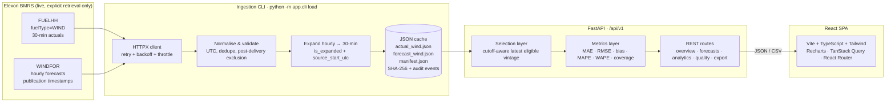

# WindIQ — UK Wind Forecast Intelligence

WindIQ is a day-ahead procurement intelligence application for UK national wind generation. It measures how Elexon's published wind forecast performed against Elexon's observed wind outturn for **January 2026**, using only the information that would have been available at a configurable day-ahead decision cutoff.

The product is deliberately narrow: **Elexon BMRS FUELHH (`fuelType=WIND`) actuals + WINDFOR forecasts, nothing else**. No price, demand, solar, interconnector, weather or other-fuel data is ingested or displayed. It is a forecast-error diagnostic, not a trading system.

   

---

## Contents

- [What it does](#what-it-does)
- [Screens](#screens)
- [Architecture](#architecture)
- [Data sources and verified contract](#data-sources-and-verified-contract)
- [Decision cutoff and no-look-ahead rule](#decision-cutoff-and-no-look-ahead-rule)
- [Metrics](#metrics)
- [Real-data validation](#real-data-validation)
- [Quickstart](#quickstart)
- [Docker Compose](#docker-compose)
- [API reference](#api-reference)
- [Project layout](#project-layout)
- [Configuration](#configuration)
- [Testing and quality gates](#testing-and-quality-gates)
- [Deployment guide](#deployment-guide)
- [Limitations and non-goals](#limitations-and-non-goals)

---

## What it does

For every 30-minute settlement period in January 2026, WindIQ:

1. Resolves the **decision cutoff** — 11:00 Europe/London on the preceding calendar day by default.
2. Selects the **latest WINDFOR publication at or before that cutoff** for the delivery interval.
3. Joins the **latest FUELHH actual** for the same interval.
4. Computes error metrics, distributions, daily/hourly/lead-time breakdowns, forecast-revision curves and full data-provenance evidence.

If no forecast was published before the cutoff, the interval is reported as `missing_forecast` — it is **never backfilled** with a later publication. Forecasts published after the cutoff are excluded from decision analysis and, where relevant, labelled as retrospective-only.

## Screens

| Route | Purpose |
| --- | --- |
| `/` | **Overview** — headline KPIs, forecast vs actual trend, daily error, worst intervals, publication freshness. |
| `/forecasts` | **Forecast Explorer** — every settlement interval with filters, search, status, pagination, CSV export and a per-interval vintage drawer. |
| `/accuracy` | **Accuracy Analysis** — MAE/RMSE/bias/MAPE/WAPE/coverage, error distribution, heatmap, hourly profile, lead-time table, daily diagnostics. |
| `/revisions` | **Forecast Revisions** — decision vintage vs latest pre-delivery publication, revision curve, largest revisions, vintage paths. |
| `/data-quality` | **Data Quality** — upstream probe, cache SHA-256 manifest, retrieval audit trail, coverage by day, invalid/missing/post-delivery accounting. |
| `/methodology` | **Methodology** — sources, field mapping, cutoff, selection rules, metric formulas, limitations, reproduction commands. |

All six routes share a persistent filter bar (date window, cutoff time, cutoff days-before, vintage mode, lead-time bucket). Filters are stored in `localStorage` and are reflected in every query key.

## Architecture



Key design decisions:

- **Cache is the serving layer.** Analytics never hit the network at request time. Ingestion is an explicit CLI action, so a transient Elexon outage cannot silently change displayed figures.
- **No database.** The dataset is small and immutable for this analysis; a file-backed JSON cache with atomic writes and a SHA-256 manifest is easier to audit than a database and keeps the deployment single-container.
- **Service layer separation.** `routes.py` handles HTTP only; `selection.py` owns cutoff semantics; `metrics.py` owns pure numeric functions; `normalize.py` owns parsing/validation; `service.py` orchestrates.
- **UTC internally, London at the edges.** The expected interval grid is DST-aware, so coverage denominators stay correct on 46/50-period days.

## Data sources and verified contract

The contract was checked against the live OpenAPI description at `https://data.elexon.co.uk/swagger/v1/swagger.json` (OpenAPI 3.0.4).

| Dataset | Endpoint | Filtering | Granularity | Auth |
| --- | --- | --- | --- | --- |
| FUELHH | `/datasets/FUELHH/stream` | Settlement date (`settlementDateFrom` / `settlementDateTo`) | 30 min | None |
| WINDFOR | `/datasets/WINDFOR/stream` | Publication window (`publishDateTimeFrom` / `publishDateTimeTo`) | 60 min | None |

Important contract facts encoded in the client:

- WINDFOR **does not** support delivery-date filtering; retrieval must be publication-window based. The ingestion window is padded (8 days before, 3 days after) so decision vintages are captured.
- Settlement-date and publish-time filters are **mutually exclusive**, so the two datasets are always fetched separately.
- No pagination, no authentication. HTTP 429 is handled by retry/backoff; the documented quota is not numerically specified.
- FUELHH `fuelType` is filtered to `WIND`; WINDFOR is national wind by definition.
- Each hourly WINDFOR value is applied to both 30-minute settlement periods it covers and flagged `is_expanded`, with the raw hourly start retained in `source_start_utc`.

### Provenance controls

- Atomic cache writes (`*.tmp` → rename).
- SHA-256 per cache file plus record counts, retrieval timestamps, endpoint, parameters, attempts and duration in `manifest.json`.
- Post-delivery publications (published at or after the delivery interval start) are excluded and counted as `excluded_post_delivery_records` — **not** as invalid data.
- Duplicate policy: latest publication wins for actuals; conflicting exact-key forecast duplicates are averaged and counted as `duplicate_conflicts`.
- No synthetic data is ever served. The running service only reads the cache; synthetic fixtures exist solely inside the test suite.

## Decision cutoff and no-look-ahead rule

```text
cutoff_utc = Europe/London localise(
    (delivery_date - cutoff_days_before) at cutoff_time
)

eligible  = forecast records where publish_time_utc <= cutoff_utc
selected  = the eligible record with max(publish_time_utc) per delivery interval
actual    = latest FUELHH record for that delivery interval
```

- Default cutoff: **11:00 Europe/London, one calendar day before delivery**.
- This is a **labelled pilot assumption**, not a claim about any client's actual trading deadline. It is configurable per request (`cutoff`, `cutoff_days_before`).
- The boundary is **inclusive**: a publication at exactly 11:00 is eligible.
- `vintage=latest_available` exists only for retrospective comparison. It is visually flagged and is never the default for headline KPIs.

## Metrics

Error is always `forecast_mw − actual_mw`. Positive bias means overforecast.

| Metric | Unit | Formula | Notes |
| --- | --- | --- | --- |
| MAE | MW | `mean(abs(error))` | Not a percentage. |
| RMSE | MW | `sqrt(mean(error²))` | Penalises large misses. |
| Bias | MW | `mean(error)` | Signed direction. |
| MAPE | % | `mean(abs(error / actual)) × 100` | Only where `abs(actual) ≥ 1.0 MW`; excluded count reported. |
| WAPE | % | `sum(abs(error)) / sum(actual) × 100` | Volume-weighted; robust to low generation. |
| Coverage | % | `matched / expected_intervals × 100` | Expected grid is DST-aware, not assumed 48/day. |

Every metric carries its observation count `n`. Charts and tables never present MAE/RMSE as accuracy percentages, and empty lead-time buckets are shown as empty rather than zero-error.

## Real-data validation

The committed cache was retrieved from Elexon BMRS and verified in the running application. These are the actual figures for the default selection (1–31 Jan 2026, decision cutoff 11:00 London, D−1):

| Quantity | Value |
| --- | --- |
| FUELHH actual records (WIND) | **1,488** |
| WINDFOR source records (hourly) | **19,487** |
| WINDFOR source delivery intervals | 1,051 (2,102 expanded 30-min rows) |
| Forecast vintages | **336** |
| Expected settlement intervals | 1,488 |
| Missing actual / missing forecast | **0 / 0** |
| Coverage | **100.0%** |
| Excluded post-delivery publications | 5,041 |
| Invalid / duplicate / naive-timestamp records | **0 / 0 / 0** |
| MAE | **2,126.12 MW** (n = 1,488) |
| RMSE | **2,620.80 MW** (n = 1,488) |
| Bias | **+1,840.30 MW** (overforecast) |
| MAPE | **22.13%** (n = 1,488, 0 excluded) |
| WAPE | **18.36%** (n = 1,488) |

Headline interpretation: the decision-cutoff forecast ran **high by 1.84 GW on average** across January 2026, with a typical miss of ~2.1 GW. That is a material bias for a procurement team, and it is the central finding the interface is designed to surface.

Population caveats that are visible in the UI:

- Under the 11:00 D−1 cutoff, only lead-time buckets from **12–18 h through 36–48 h** are populated. `< 6 h`, `6–12 h` and `48 h+` are empty and are shown as empty, not as zero error.
- The largest revision in the period is **2026-01-28 SP 36**: decision 10,839 MW, latest pre-delivery 5,806 MW, revision **−5,033 MW**, actual 5,540 MW, 22 vintages.
- `latest_available` mode will differ from these numbers because it admits post-cutoff publications. That is expected and is flagged in the UI.

## Quickstart

Requirements: Python 3.12+ (3.14 verified locally), Node 20+.

### Backend

```bash
cd backend
python -m venv .venv
# Windows
.venv\Scripts\activate
# macOS / Linux
source .venv/bin/activate

pip install -r requirements-dev.txt

# Regenerate the cache from Elexon (explicit network access)
python -m app.cli load --start 2026-01-01 --end 2026-01-31

# Verify cached state without touching the network
python -m app.cli status
python -m app.cli validate

uvicorn app.main:app --host 127.0.0.1 --port 8000
```

- API root: `http://127.0.0.1:8000/api/v1`
- OpenAPI UI: `http://127.0.0.1:8000/docs`
- Health: `http://127.0.0.1:8000/api/v1/health?probe=false`

The committed cache means you can skip `load` and start the API immediately for an offline demo.

### Frontend

```bash
cd frontend
npm install
npm run dev        # http://localhost:5173
```

Vite proxies `/api` to `http://127.0.0.1:8000`. To point at a different backend at build time, set `VITE_API_BASE_URL` to that backend's versioned root, e.g. `https://<your-backend-host>/api/v1`.

```bash
npm run build      # tsc -b && vite build → dist/
npm run preview    # serve the production build on :4173
npm run lint       # eslint, zero warnings allowed
```

## Docker Compose

```bash
cp .env.example .env
docker compose up --build
```

- Web UI: `http://localhost:8080`
- API: `http://localhost:8000/api/v1`
- The web container's nginx proxies `/api/` to the `api` service and falls back to `index.html` for SPA routes.
- The verified cache is bind-mounted from `backend/data/cache` so the container serves the committed data and any host-side re-ingestion is visible immediately.
- Both images run as non-root users and define healthchecks.

> **Verification status:** verified end-to-end. Both images build (`windiq/api:1.0.0`, `windiq/web:1.0.0`), `docker compose up --build` brings the stack up, both containers report healthy, and the UI was exercised in a browser against the containerised build: all six routes render with zero console errors, the nginx `/api/` proxy returns the same KPIs as the host run (MAE 2,126.12 MW, 1,488 paired intervals), and CSV export returns 1,488 rows. The verification run used `API_PORT=8010`/`WEB_PORT=8090` only because the host dev servers already held 8000/5173; the Compose file itself is unchanged.

Two container-specific details are worth knowing:

- `frontend/nginx.conf` is a complete `nginx.conf`, not a `conf.d` snippet. The image runs as uid 10002, so the pid file and all temp paths live under `/tmp`; the stock config's `/run/nginx.pid` is root-owned and makes nginx exit with `Permission denied`.
- The `/api/` upstream is resolved at request time through Docker's embedded DNS (`resolver 127.0.0.11`), so `nginx -t` succeeds during the image build and a recreated API container is picked up without restarting the web container.

To seed a fresh cache from Elexon, run ingestion on the host (it writes the same bind-mounted directory):

```bash
cd backend
python -m app.cli load --start 2026-01-01 --end 2026-01-31
```

Running ingestion inside the container may fail on Linux hosts because the bind-mounted files are owned by your host user while the container runs as uid 10001.

## API reference

Base path `/api/v1`. All analysis endpoints accept the shared filter query parameters:

| Parameter | Type | Default | Description |
| --- | --- | --- | --- |
| `start_date` | date | 2026-01-01 | First London delivery date. |
| `end_date` | date | 2026-01-31 | Last London delivery date. |
| `cutoff` | `HH:MM` | 11:00 | Europe/London cutoff clock time. |
| `cutoff_days_before` | int 0–7 | 1 | Calendar days before delivery. |
| `vintage` | enum | `decision_cutoff` | `decision_cutoff` enforces no look-ahead; `latest_available` is retrospective. |
| `lead_time_bucket` | enum | none | `lt6`, `6to12`, `12to18`, `18to24`, `24to36`, `36to48`, `gte48`. |

| Method | Path | Returns |
| --- | --- | --- |
| GET | `/health` | Liveness, dataset state, optional upstream probe. |
| GET | `/metadata` | Product, sources, cutoff, metric definitions, limitations. |
| GET | `/overview` | KPIs, forecast/actual series, daily errors, extremes, status. |
| GET | `/forecasts` | Paged interval rows (`page`, `page_size`, `status`, `search`, `sort_by`, `sort_dir`). |
| GET | `/forecasts/{delivery_interval}/vintages` | Full publication path for one interval, with eligibility flags. |
| GET | `/analytics/summary` | Metric set, error stats, direction split, distribution, lead-time buckets. |
| GET | `/analytics/daily` | Per-day metrics and coverage. |
| GET | `/analytics/hourly` | Hour-of-day profile plus date × hour heatmap. |
| GET | `/analytics/lead-time` | Lead-time buckets and revision curve. |
| GET | `/analytics/revisions` | Revision summary, top revisions, vintage counts. |
| GET | `/data-quality` | Upstream probe, cache manifest, coverage, counts, audit trail. |
| GET | `/export` | Filtered CSV download with provenance columns. |
| POST | `/data/refresh` | Disabled by default; requires `ALLOW_REFRESH=true` plus an `X-Admin-Token` header when `ADMIN_TOKEN` is configured. |

Errors use a consistent envelope:

```json
{
  "error": {
    "code": "VALIDATION_ERROR",
    "message": "One or more request parameters are invalid.",
    "details": { "errors": [] },
    "request_id": "..."
  }
}
```

## Project layout

```text
backend/
  app/
    api/            # routes, dependencies, error handlers
    services/       # client, ingestion, normalize, cache, selection, metrics, service
    schemas.py      # Pydantic response models
    config.py       # env-driven settings
    cli.py          # load / status / validate
  data/cache/       # verified January 2026 JSON + manifest
  tests/            # 66 tests, synthetic fixtures only
  Dockerfile
frontend/
  src/
    components/     # shell, sidebar, top bar, filter bar, charts, drawer, primitives
    pages/          # the six screens
    features/filters/
    lib/            # typed API client, types, formatters
  Dockerfile
  nginx.conf
docs/
  TECHNICAL_WALKTHROUGH.md
  CLIENT_DEMO_SCRIPT.md
  TECHNICAL_DEMO_SCRIPT.md
docker-compose.yml
.github/workflows/ci.yml
```

## Configuration

All backend settings are environment driven (see `.env.example`). The most relevant:

| Variable | Default | Effect |
| --- | --- | --- |
| `DEFAULT_CUTOFF_TIME` | `11:00` | Default decision cutoff clock time. |
| `DEFAULT_CUTOFF_DAYS_BEFORE` | `1` | Default preceding-day offset. |
| `MAPE_MIN_ACTUAL_MW` | `1.0` | MAPE denominator threshold. |
| `CACHE_STALE_AFTER_HOURS` | `168` | Staleness badge threshold; does not block reads. |
| `CORS_ORIGINS` | localhost origins | Comma-separated allowed origins. |
| `ALLOW_REFRESH` | `false` | Enables `POST /data/refresh`. |
| `ADMIN_TOKEN` | empty | When set, required in the `X-Admin-Token` header for refresh. |
| `VITE_API_BASE_URL` | `/api/v1` | Frontend build-time API base. |

## Testing and quality gates

```bash
cd backend
.venv\Scripts\python.exe -m pytest -q
.venv\Scripts\python.exe -m ruff check app tests

cd ../frontend
npm run lint
npm run build
```

Verified state at delivery:

- Backend: **66 tests passing**, `ruff check app tests` clean.
- Frontend: `npm run lint` clean with `--max-warnings=0`; `tsc -b && vite build` succeeds (~797 kB JS / 38 kB CSS before gzip).
- Browser checks: all six routes load with zero console errors; KPI, chart, table, filter, search, CSV export, interval drawer, revisions drawer, data-quality re-probe and methodology anchors exercised against the live backend.

CI (`.github/workflows/ci.yml`) runs backend lint + tests on Python 3.12, frontend lint + build on Node 20, then validates both Docker images build.

## Deployment guide

### Frontend on Vercel

1. Import the repository and set **Root Directory** to `frontend`.
2. Framework preset: **Vite**. Build command `npm run build`, output `dist`.
3. Set `VITE_API_BASE_URL` to the public backend URL, e.g. `https://<your-backend-host>/api/v1`.
4. Vercel's Vite preset handles SPA fallback automatically. If you deploy the static `dist/` elsewhere, configure a catch-all rewrite to `/index.html` that excludes real files and the `/api` prefix; otherwise deep links such as `/accuracy` will 404.

The backend must allow the Vercel origin in `CORS_ORIGINS`.

### Backend on Render / Fly.io / any container host

- Build from `backend/Dockerfile` (Python 3.12 slim, non-root, healthcheck on `/api/v1/health?probe=false`).
- Set `ENVIRONMENT=production`, `CORS_ORIGINS=https://<your-vercel-domain>`, and keep `ALLOW_REFRESH=false` unless you need the protected refresh route.
- Mount a persistent disk at `/app/data/cache` if you intend to re-ingest. Otherwise bake the committed cache into the image, which is what the Dockerfile does.
- Do **not** run ingestion on every boot; it is an explicit operational action.

### Single-origin alternative

Deploy both containers with `docker-compose.yml` behind one host: nginx serves the SPA and proxies `/api/` to the API. This avoids CORS entirely and is the simplest production topology.

> No live deployment URL is claimed in this repository. The figures above come from a locally running instance against the committed cache.

## Limitations and non-goals

- January 2026 is analysed retrospectively; Elexon may revise actual outturn after initial publication.
- The 11:00 D−1 cutoff is a pilot assumption and must be confirmed against the client's real procurement deadline.
- WINDFOR is hourly; expansion to 30-minute settlement periods is an explicit modelling assumption, not additional information.
- Only national wind is covered. There is no regional, offshore/onshore split, price, demand, interconnector or balancing data.
- The application does not size trades, hedges or bids and must not be used as though it could.
- Docker Compose has not been executed in the delivery environment (daemon unavailable); see the verification note above.

---

Built for a day-ahead procurement team. Data: Elexon BMRS FUELHH + WINDFOR. Not a trading recommendation.
