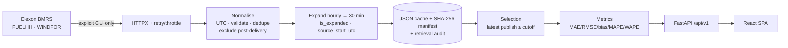

# WindIQ — Technical Demo Script

**Audience:** engineers, data scientists, platform/security reviewers.
**Duration:** 25–30 minutes (fast path ~15 minutes).
**Precondition:** the committed Elexon cache is present at `backend/data/cache/`.

This script is reproducible: every command and every number below was executed against the delivered build. Where something was **not** verified, it says so.

---

## 0. Setup (2 minutes)

Two terminals from the repository root.

**Terminal A — backend**

```powershell
cd backend
.\.venv\Scripts\python.exe -m uvicorn app.main:app --host 127.0.0.1 --port 8000
```

If the venv does not exist:

```powershell
python -m venv .venv
.\.venv\Scripts\python.exe -m pip install -r requirements-dev.txt
```

**Terminal B — frontend**

```powershell
cd frontend
npm install
npm run dev
```

Open `http://localhost:5173`. API docs: `http://localhost:8000/docs`.

Sanity checks:

```powershell
Invoke-RestMethod http://127.0.0.1:8000/api/v1/health?probe=false | ConvertTo-Json -Depth 4
Invoke-RestMethod http://127.0.0.1:8000/api/v1/metadata | ConvertTo-Json -Depth 3
```

The health payload should report `dataset_loaded: true` and `data.is_synthetic: false`, with non-zero actual/forecast record counts.

---

## 1. Architecture in 90 seconds (3 minutes)

Draw the flow on screen (or open the Mermaid block in `README.md`):



Talking points:

- **Two-phase system.** Ingestion is offline and explicit; serving is read-only from cache. This is why an Elexon outage cannot change a displayed number.
- **No database.** Small immutable dataset; atomic JSON writes plus a hash manifest are more auditable and keep deployment to two containers.
- **One authoritative rule.** `selection.py` owns the no-look-ahead decision. Everything downstream consumes its output frame.
- **UTC internally.** London only at the boundaries; the delivery grid is DST-aware.

---

## 2. Code walkthrough — the cutoff rule (5 minutes)

Open `backend/app/services/selection.py`.

Walk through `build_selection`:

1. **Expected grid** — `build_grid` produces one row per expected settlement period from the London calendar (`build_delivery_grid`), so DST days yield 46/50 periods, not a hard-coded 48.
2. **Cutoff per delivery date** — `cutoff_for_delivery_date` localises `(delivery_date − days_before)` at `cutoff_time` in `Europe/London` and converts to UTC. Cached via `lru_cache`.
3. **Eligibility filter** — the key line:

```python
candidates = forecasts[
    forecasts["publish_time_utc"] <= forecasts["cutoff_time_utc"]
]
```

4. **Selection** — stable sort by `(delivery_start_utc, publish_time_utc)` then `drop_duplicates(keep="last")`. Ties resolve to the latest publication deterministically.
5. **Left join onto the grid** — missing eligible forecasts stay in the population with nulls, so they surface as `missing_forecast` rather than disappearing.
6. **Status and compliance flags** — `status` ∈ `matched | missing_actual | missing_forecast`; `is_cutoff_compliant` is computed from the actual publish/cutoff pair and is what the Explorer reports as **Cutoff compliant: 100.0%**.

Point out `interval_vintages`: same cutoff, then `eligible = publish_time_utc <= cutoff` per publication, which is what the drawer renders.

Then open `backend/app/services/metrics.py`:

- All functions drop null/non-finite pairs first.
- MAPE applies the denominator threshold and returns `(Metric, excluded_count)`.
- No function mutates the input frame.
- `matched()` in `selection.py` is the only entry point for metric computation — unpaired rows can never enter a metric.

Open `backend/app/services/normalize.py` and show the counters: `invalid_records`, `duplicates_removed`, `duplicate_conflicts`, `naive_timestamps`, `excluded_post_delivery`. Emphasise that post-delivery exclusion is **not** invalid data — it is the rule working.

---

## 3. API demonstration (6 minutes)

Run these in order. Expected outputs are from the delivered cache.

### 3.1 Metadata and cutoff

```powershell
$b = 'http://127.0.0.1:8000/api/v1'
(Invoke-RestMethod "$b/metadata").cutoff | ConvertTo-Json
```

Expected: `11:00`, `1` day before, `Europe/London`, `assumption: true`.

### 3.2 Headline metrics

```powershell
(Invoke-RestMethod "$b/analytics/summary").metrics | ConvertTo-Json -Depth 4
```

Expected:

| Metric | Value | n |
| --- | --- | --- |
| MAE | 2126.12 | 1488 |
| RMSE | 2620.8 | 1488 |
| bias | 1840.3 | 1488 |
| MAPE | 22.13 | 1488 |
| WAPE | 18.36 | 1488 |
| coverage | 100.0 | 1488 (expected 1488) |

### 3.3 Population accounting

```powershell
$s = Invoke-RestMethod "$b/analytics/summary"
$s.population | ConvertTo-Json
```

Expected: `expected_intervals 1488`, `selected_intervals 1488`, `matched_intervals 1488`, `missing_forecast 0`, `missing_actual 0`.

### 3.4 Filter semantics

```powershell
$f = Invoke-RestMethod "$b/forecasts?lead_time_bucket=12to18&page_size=1"
$f.pagination.total_items          # 217
(Invoke-RestMethod "$b/forecasts?lead_time_bucket=12to18&page_size=1").population | ConvertTo-Json
```

The population block should show `excluded_by_lead_time = 1488 − 217 = 1271`. That is the accounting guarantee: filtering never silently changes the denominator.

```powershell
(Invoke-RestMethod "$b/forecasts?search=2026-01-12&page_size=1").pagination.total_items   # 48
```

### 3.5 One interval's full publication path

```powershell
$v = Invoke-RestMethod "$b/forecasts/2026-01-01T00:00:00Z/vintages?cutoff=11:00&cutoff_days_before=1"
$v.cutoff | ConvertTo-Json
$v.decision_forecast | ConvertTo-Json
$v.latest_forecast | ConvertTo-Json
$v.revision | ConvertTo-Json
$v.vintages.Count
($v.vintages | Where-Object eligible).Count
```

Expected:

- cutoff UTC `2025-12-31T11:00:00Z`
- decision forecast `19466` published `2025-12-31T09:30:00Z`, error `5710`
- latest pre-delivery forecast `20032` published `2025-12-31T22:30:00Z`
- revision object: `n_vintages 16`, `n_eligible_vintages 12`, `latest_minus_decision_mw 566`
- 16 vintages, 12 eligible

This is the proof that later publications exist but do not enter the decision number.

### 3.6 Empty lead-time buckets are real

```powershell
$l = Invoke-RestMethod "$b/analytics/lead-time"
$l.buckets | Select-Object key, label, n, mae | Format-Table
```

Expected: `lt6`, `6to12` and `gte48` have `n = 0`; the populated buckets run from `12to18` through `36to48`. Explain the structural reason: a fixed 11:00 D−1 cutoff cannot see anything fresher than ~12 h for the following day.

### 3.7 Revisions

```powershell
$r = Invoke-RestMethod "$b/analytics/revisions?limit=20"
$r.summary | ConvertTo-Json
$r.top[0] | ConvertTo-Json -Depth 3
```

Expected summary: `intervals_with_vintages 1488`, `mean_abs_revision_mw 977.92`, `max_abs_revision_mw 5033.0`.

Top row: `2026-01-28T17:30:00Z`, SP 36, decision `10839`, latest `5806`, revision `-5033`, actual `5540`, `n_vintages 22`.

### 3.8 Data quality and provenance

```powershell
$q = Invoke-RestMethod "$b/data-quality?probe=true"
$q.data | ConvertTo-Json -Depth 3
$q.cache.files | ConvertTo-Json -Depth 3
$q.counts | ConvertTo-Json
```

Expected: `actual_records 1488`, `forecast_records 19487`, `forecast_vintages 336`, `excluded_post_delivery_records 5041`, `invalid_records 0`, `duplicates_removed 0`, `is_synthetic false`, two SHA-256 hashes.

### 3.9 CSV export

```powershell
$response = Invoke-WebRequest "$b/export?search=2026-01-12" -UseBasicParsing
$response.Headers['X-Row-Count']
($response.Content.TrimEnd() -split "`n").Count
($response.Content -split "`n")[0]
```

Expected: `X-Row-Count: 48`; 49 lines including header (trim the trailing newline before splitting); header begins `delivery_date,settlement_period,interval_start_london,...` and includes `cutoff_compliant,data_source,synthetic`.

### 3.10 Error envelope

```powershell
try { Invoke-RestMethod "$b/forecasts?cutoff=25:99" } catch { $_.ErrorDetails.Message }
```

Expected: a structured `error` object with `code`, `message`, `details` and `request_id`; HTTP 422.

### 3.11 Refresh is gated

```powershell
try { Invoke-RestMethod -Method Post "$b/data/refresh" } catch { $_.Exception.Response.StatusCode.value__ }
```

Expected: `403` because `ALLOW_REFRESH` defaults to false. Explain the two-key guard (`ALLOW_REFRESH` + `X-Admin-Token`).

---

## 4. Frontend walkthrough (6 minutes)

### 4.1 Bootstrap and state

Open `frontend/src/main.tsx`: QueryClient defaults (retry 1, `staleTime 60s`, no refetch on focus), `FilterProvider`, `BrowserRouter`.

Open `frontend/src/features/filters/FilterProvider.tsx`:

- `FilterState` is camelCase and localStorage-backed under `windiq.filters.v1`.
- The provider derives `apiFilters` (snake_case) once, so pages use the same object for `queryKey` and `queryFn`. No page-level mapping duplication, no cache-key drift.
- Analysis dates are pinned to the pilot window even if storage is stale.

### 4.2 Typed client

Open `frontend/src/lib/api.ts`:

- base URL from `VITE_API_BASE_URL` else `/api/v1`,
- null filters omitted from the query string,
- non-2xx mapped to a typed `ApiError` with `code/message/requestId`,
- `exportUrl()` returns a URL for direct navigation, so CSV download is not buffered in memory.

### 4.3 Query states

Open `frontend/src/components/common.tsx` → `QueryState`. Demonstrate by stopping the backend briefly (optional, 10 seconds):

1. Stop Terminal A.
2. Refresh a page → error panel with retry.
3. Restart the backend, click **Retry** → data returns.

If you would rather not disturb the demo, just show the component's three branches in code.

### 4.4 Explorer interaction checklist

1. `/forecasts` → header badges: **1,488 rows**, **1,488 matched**, **Cutoff compliant: 100.0%**.
2. Lead time `12–18 h` → **217 rows**; confirm the population block shows `excluded_by_lead_time 1271`.
3. Reset → 1,488; search `2026-01-12` → **48 rows**.
4. Open the first row → drawer: 16 publications, 12 eligible, decision forecast 19,466 MW, actual 13,756 MW, error +5,710 MW.
5. Press **Escape** → drawer closes, focus returns.
6. Page size 200 → table paginates; sort by `|error|` desc → largest miss first.
7. Export filtered CSV → 49 lines for the search.

### 4.5 Accuracy interaction checklist

1. `/accuracy` → 6 KPI cards, badge **1,488 paired intervals**.
2. Error distribution — confirm the mass sits in positive bins (consistent with +1,840 MW bias).
3. Heatmap — date × hour, amber = higher MAE.
4. Lead-time table — only populated buckets have numbers; empty buckets show `—`, not `0`.
5. Click **First half** → **720 paired intervals**; **Full month** → back to 1,488.

### 4.6 Revisions interaction checklist

1. `/revisions` → top row 28 Jan SP 36, revision −5,033 MW.
2. Click the row → drawer with the 22-vintage path; decision 10,839 → latest 5,806.
3. Close via the button and via Escape.
4. Point at the amber retrospective notice.

### 4.7 Data Quality and Methodology

1. `/data-quality` → click a SHA-256 chip to copy; click **Re-check upstream** and watch it refetch without errors.
2. `/methodology` → click the ten TOC anchors; confirm the cutoff pseudocode, MAPE threshold (1.0 MW) and limitations list.

---

## 5. Automated verification (4 minutes)

### 5.1 Backend tests and lint

```powershell
cd backend
.\.venv\Scripts\python.exe -m pytest -q
.\.venv\Scripts\python.exe -m ruff check app tests
```

Expected: **66 passed**; ruff reports no issues.

Call out the test files by concern:

| File | Focus |
| --- | --- |
| `test_timeutils.py` | UTC parsing, London conversion, DST-aware grid. |
| `test_normalize.py` | Validation, dedupe, conflicts, post-delivery exclusion, expansion. |
| `test_selection.py` | Cutoff resolution, inclusive boundary, latest-eligible selection, no backfill, latest-available mode. |
| `test_metrics.py` | MAE/RMSE/bias/MAPE threshold/WAPE, empty series, distributions. |
| `test_ingestion.py` | Cache writes, idempotent re-ingestion, partial-failure handling, manifest contents. |
| `test_api.py` | Every route, filter validation, pagination, CSV headers, error envelopes. |

### 5.2 Frontend lint and build

```powershell
cd frontend
npm run lint
npm run build
```

Expected: eslint clean with `--max-warnings=0`; `tsc -b` clean; Vite emits `dist/` (~797 kB JS, ~38 kB CSS before gzip).

### 5.3 Offline cache validation

```powershell
cd backend
.\.venv\Scripts\python.exe -m app.cli status
.\.venv\Scripts\python.exe -m app.cli validate
```

Expected: cache files present, `actual_records 1488`, `is_synthetic false`, no `load_error`; `validate` reports 1,488 expected/matched, 0 missing and `cutoff_violations: 0`. These commands do not touch the network.

---

## 6. Deployment and CI (3 minutes)

Open `.github/workflows/ci.yml`:

- `backend` job — Python 3.12, `pip install -r requirements-dev.txt`, `ruff check`, `pytest`.
- `frontend` job — Node 20, `npm ci`, `npm run lint`, `npm run build`.
- `docker` job — Buildx builds both images with GitHub Actions layer cache. This is the gate for Dockerfile regressions; a manual `docker compose up --build` covered startup and routing.

**Live deployment (open the URLs):**

- Web app: https://ohnrn-web.vercel.app
- API: https://ohnrn-api.vercel.app/api/v1 — docs at `/docs`
- Health: https://ohnrn-api.vercel.app/api/v1/health?probe=false

> "The frontend is a static Vite build on Vercel; the API is a Vercel Python function. Vercel detects the FastAPI `app` in `backend/app/main.py`, so there is no adapter. Dependencies come from `pyproject.toml` — Vercel ignores `requirements.txt` when that file exists — and `vercel.json` bundles `data/cache/**` with the function. The function filesystem is read-only, which is fine: the API only reads the cache and the refresh endpoint stays disabled. Live KPIs match the local run exactly: MAE 2,126.12 MW over 1,488 paired intervals, export 1,488 rows, all six routes with zero console errors."

Open `docker-compose.yml`:

- `api` builds `backend/`, bind-mounts the committed cache, exposes 8000, healthchecks `/api/v1/health?probe=false`.
- `web` builds `frontend/` with `VITE_API_BASE_URL=/api/v1`, depends on `api` being healthy, exposes 8080.
- nginx serves static assets, proxies `/api/` to `api:8000`, SPA-falls back to `index.html`, and adds security headers. It runs unprivileged, so the pid and temp paths live under `/tmp`, and the `/api/` upstream is resolved through Docker DNS at request time.

**Show the verified result:**

> "Both images build and the stack runs. `docker compose ps` reports both containers healthy, the UI was exercised in a browser on all six routes with zero console errors, and the nginx proxy returns the same KPIs as the host run — MAE 2,126.12 MW over 1,488 paired intervals. CSV export returns 1,488 rows."

```powershell
Copy-Item .env.example .env
docker compose up --build
# Web http://localhost:8080 · API http://localhost:8000/api/v1
```

> If the daemon is not running, `docker info` fails with `failed to connect to the docker API at npipe:////./pipe/dockerDesktopLinuxEngine`. Start Docker Desktop and retry; it is a per-user app, not a Windows service, so nothing starts it automatically.

And the ingestion command, run on the host so the bind-mounted cache stays writable:

```powershell
cd backend
.\.venv\Scripts\python.exe -m app.cli load --start 2026-01-01 --end 2026-01-31
```

---

## 7. Design decisions and trade-offs (2 minutes)

| Decision | Why | Cost |
| --- | --- | --- |
| File cache, no DB | Auditable, atomic, offline-capable, single-container deploy. | Not concurrent-writer safe; scaling to years needs partitioning. |
| Explicit ingestion | No silent data changes; reproducible demo. | Operators must run a command; no auto-refresh. |
| Fixed analysis window in UI | Keeps the pilot honest and cache-consistent. | API is more flexible than the UI. |
| Hourly → 30-min expansion | Matches FUELHH granularity. | Modelling assumption; flagged per row. |
| Inclusive cutoff boundary | Deterministic and defensible. | Must be re-confirmed for a real deadline. |
| `latest_available` mode | Enables retrospective comparison. | Requires clear labelling to avoid look-ahead misuse. |

---

## 8. Known gaps (say these before you are asked)

1. **No automated container smoke test** — the Compose stack was verified manually (build, health, all six routes, proxy, CSV). CI builds both images but does not start the stack or hit `/healthz`.
2. **No automated frontend tests** — browser verification was manual; Playwright against the seeded cache is the next step.
3. **No read auth** — put an SSO proxy in front for production.
4. **January 2026 only** — extending the window is an ingestion change plus cache partition, not a redesign.
5. **No price/demand/volume modelling** — deliberate scope boundary, stated in the Methodology page.

---

## 9. Fast path (15 minutes)

If time is tight:

1. Architecture diagram + cutoff rule (3 min).
2. `analytics/summary` + `vintages` API calls (3 min).
3. Explorer: lead-time filter, search, row drawer (3 min).
4. Revisions: 28 Jan SP 36 (2 min).
5. Data Quality: hashes, counts, post-delivery exclusion (2 min).
6. Tests: `pytest -q` and `npm run build` (2 min).
7. Gaps and Docker caveat (1 min).
