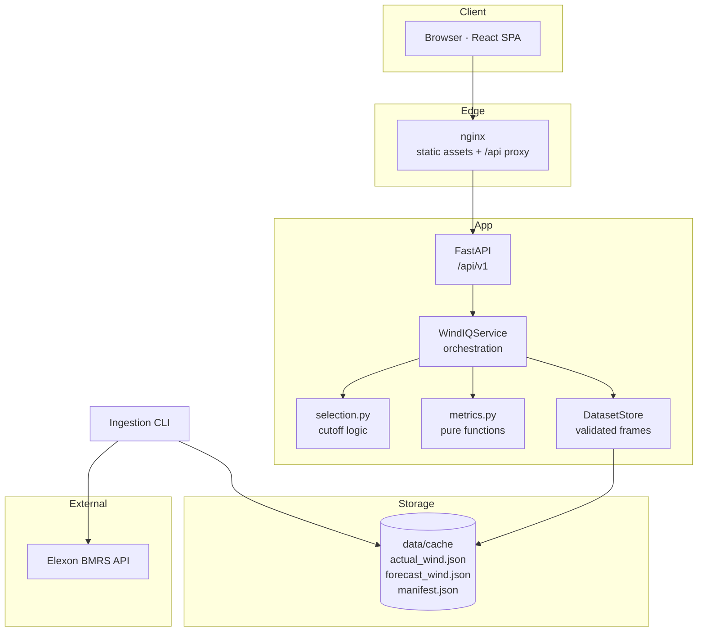

# WindIQ — Technical Walkthrough

This document is the engineering reference for WindIQ. It explains the architecture, the no-look-ahead selection algorithm, the metric mathematics, the API contract, the frontend data flow, the verification evidence, and the known gaps. It assumes familiarity with Python, TypeScript and electricity market settlement periods.

Companion documents:

- [`CLIENT_DEMO_SCRIPT.md`](./CLIENT_DEMO_SCRIPT.md) — narrative walkthrough for a procurement audience.
- [`TECHNICAL_DEMO_SCRIPT.md`](./TECHNICAL_DEMO_SCRIPT.md) — click-by-click technical demo.

---

## 1. Problem statement

A day-ahead procurement team must decide how much national wind generation to expect for each half hour of the following day. Elexon publishes two relevant streams:

- **FUELHH** — half-hourly actual generation by fuel type. `fuelType=WIND` gives the observed national wind outturn.
- **WINDFOR** — hourly national wind forecasts, published repeatedly throughout the day, each publication carrying a `publishTime`.

The analytical question is not "how accurate is the forecast in general" but **"how accurate was the forecast that was actually available when we had to decide?"** That distinction drives the entire design: every interval must be evaluated against the latest publication at or before a defined cutoff, and later publications must never leak into the decision view.

## 2. System context



The runtime path never calls Elexon. Only the ingestion CLI does, and only when an operator runs it.

## 3. Repository map

```text
backend/
  app/
    main.py              FastAPI app factory, lifespan, CORS, middleware
    config.py            Settings (pydantic-settings, .env aware)
    logging_config.py    Structured logging + request ID context var
    cli.py               load / status / validate commands
    api/
      deps.py            QueryFilters dependency, literals, service accessors
      errors.py          Exception handlers and unified error envelope
      v1/routes.py       All REST endpoints
    services/
      client.py          HTTPX Elexon client, retry/backoff/throttle
      ingestion.py       Window planning, chunked retrieval, orchestration
      normalize.py       Parsing, validation, dedupe, post-delivery exclusion
      cache.py           Atomic JSON cache + SHA-256 manifest + audit events
      dataset.py         Loads cache into validated pandas frames
      selection.py       Cutoff resolution, eligible vintage selection
      metrics.py         MAE/RMSE/bias/MAPE/WAPE, distributions, curves
      service.py         Query orchestration, response assembly, CSV export
    schemas.py           Pydantic response models
  tests/                 66 tests
frontend/
  src/
    main.tsx             QueryClient + FilterProvider + Router bootstrap
    App.tsx              Routes, titles, scroll reset, 404
    components/
      layout/            AppShell, Sidebar, TopBar, nav config
      charts/            Recharts wrappers with a shared dark theme
      FilterBar.tsx      Global filter controls
      IntervalDrawer.tsx Per-interval vintage path drawer
      KpiCard.tsx        KPI presentation
      common.tsx         PageHeader, ChartPanel, QueryState, KeyValue
      ui/primitives.tsx  Button, Panel, Badge, Input, Select, Skeleton, StateBlock
    features/filters/
      filters.ts         Types, defaults, context, useFilters
      FilterProvider.tsx State, localStorage persistence, API mapping
    lib/
      api.ts             Typed fetch client and URL builders
      types.ts           Full response type surface
      format.ts           MW/percent/date/time formatters
      utils.ts           cn()
    pages/               Six screens
```

## 4. Ingestion pipeline

### 4.1 Retrieval planning

`ingestion.py` splits the analysis window into retrieval chunks:

- FUELHH: settlement-date chunks (default 31 days) — the API supports settlement-date filters.
- WINDFOR: publication-window chunks (default 12 days), padded **8 days before** the analysis start and **3 days after** the analysis end.

Padding is essential: the first delivery interval of 1 January needs a publication from 31 December, and the last interval of 31 January may receive publications into February. Without padding the decision selection would show artificial `missing_forecast` gaps.

The two datasets are fetched in separate request families because Elexon treats settlement-date and publish-time filters as mutually exclusive.

### 4.2 Client behaviour

`client.py` wraps HTTPX with:

- explicit connect and read timeouts,
- bounded retries with exponential backoff on transport errors, 5xx and 429,
- a minimum inter-request interval (`ELEXON_MIN_INTERVAL_MS`, default 250 ms),
- no authentication (the endpoints are public),
- no pagination (the endpoints return full result sets for the filtered window).

There is no synthetic fallback. A failed retrieval fails the ingestion run rather than substituting data.

### 4.3 Normalisation

`normalize.py` performs, per dataset:

1. **Timestamp parsing** to timezone-aware UTC. Naive or unparseable timestamps are rejected and counted (`naive_timestamps`, `invalid_records`).
2. **Value validation** — finite, non-negative MW. Invalid samples are capped in the response for display.
3. **Post-delivery exclusion** — any forecast published at or after its delivery interval start is excluded and counted as `excluded_post_delivery`, never as invalid.
4. **Deduplication**
   - Actuals keyed by delivery interval; latest publication wins.
   - Forecasts keyed by `(delivery interval, publish time)`; identical duplicates collapse, conflicting duplicates are averaged and counted.
5. **Hourly expansion** — each WINDFOR hourly value is duplicated onto both 30-minute periods it covers, with `is_expanded=true` and `source_start_utc` retaining the original hourly start.

Resulting counts for the committed dataset:

| | FUELHH | WINDFOR |
| --- | --- | --- |
| Raw records | 1,488 | 24,528 |
| Valid records | 1,488 | 19,487 |
| Excluded post-delivery | 0 | 5,041 |
| Invalid | 0 | 0 |
| Duplicates / conflicts | 0 / 0 | 0 / 0 |
| Naive timestamps | 0 | 0 |

### 4.4 Cache and manifest

`cache.py` writes each dataset to a `.tmp` file and atomically renames it, then updates `manifest.json` with:

- file name, byte size, modification time, SHA-256,
- record count,
- last success timestamps per dataset,
- retrieval audit events: timestamp, operation, endpoint, parameters, records, attempts, duration, status.

The manifest is what the Data Quality page reads. It is the provenance record for every figure in the UI.

## 5. No-look-ahead selection

This is the most important algorithm in the system. It lives in `selection.py` and is exercised directly by `tests/test_selection.py`.

### 5.1 Cutoff resolution

```python
local_cutoff = datetime.combine(
    delivery_date - timedelta(days=cutoff_days_before),
    cutoff_time,              # default 11:00
    tzinfo=ZoneInfo("Europe/London"),
)
cutoff_utc = local_cutoff.astimezone(timezone.utc)
```

Because the localisation is explicit, a DST transition on the cutoff day resolves to the correct UTC instant rather than a fixed offset.

### 5.2 Eligibility and selection

For each expected 30-minute delivery interval in the London date range:

```text
eligible = forecasts[interval].where(publish_time_utc <= cutoff_utc)
if eligible is empty:
    status = missing_forecast
else:
    selected = eligible.max_by(publish_time_utc)   # deterministic tie-break
```

The comparison is **inclusive** of the cutoff instant.

### 5.3 Actual join

The latest FUELHH record per interval is joined, giving `matched`, `missing_actual` or `missing_forecast`.

### 5.4 Population accounting

Nothing is silently dropped. Every response carries:

| Field | Meaning |
| --- | --- |
| `expected_intervals` | DST-aware grid for the selected London dates. |
| `selected_intervals` | Intervals remaining after the optional lead-time filter. |
| `matched_intervals` | Both legs present. |
| `missing_forecast` | No eligible publication. |
| `missing_actual` | No actual record. |
| `excluded_by_lead_time` | Removed by the lead-time bucket filter after selection. |
| `mape_excluded` | Below the MAPE denominator threshold. |

### 5.5 Vintage modes

- `decision_cutoff` (default): the algorithm above.
- `latest_available`: selects the latest pre-delivery publication regardless of cutoff. Used only for retrospective comparison and flagged in the UI.

### 5.6 What the cutoff implies for lead time

With a fixed 11:00 D−1 cutoff:

- A forecast for 00:00 on day D was published at most 13 hours before delivery.
- A forecast for 23:30 on day D was published at most 36.5 hours before delivery.

Therefore only the **12–18 h, 18–24 h, 24–36 h and 36–48 h** buckets can be populated. Shorter and longer buckets are structurally empty. The UI renders them as empty and does not plot them as zero error. This is a correctness property, not a data gap.

## 6. Metric mathematics

All functions in `metrics.py` are pure and operate on paired `(forecast, actual)` series after null and non-finite filtering.

```text
error_i   = forecast_i - actual_i
MAE       = mean(|error_i|)
RMSE      = sqrt(mean(error_i²))
bias      = mean(error_i)
MAPE      = mean(|error_i / actual_i|) × 100   for |actual_i| >= mape_min_actual_mw
WAPE      = sum(|error_i|) / sum(actual_i) × 100
coverage  = matched_intervals / expected_intervals × 100
```

Additional derived outputs:

- **Direction split** — count and share of overforecast (`error > 0`) vs underforecast (`error < 0`).
- **Error quantiles** — mean, median, min, max, p95 of absolute error.
- **Distribution** — fixed-width MW bins with counts, used by the histogram.
- **Daily** — the full metric set per London delivery date plus coverage.
- **Hourly** — metrics per local hour of day, plus a date × hour MAE heatmap.
- **Lead-time** — metrics per lead-time bucket, plus mean forecast level and mean signed/absolute revision vs the decision vintage.
- **Revisions** — per interval: decision forecast, latest pre-delivery forecast, actual, signed revision, absolute revision, vintage count, latest publication time; aggregated into a revision curve by lead time.

### 6.1 MAPE policy

MAPE is undefined/unstable near zero generation. The default denominator threshold is **1.0 MW**, configurable via `MAPE_MIN_ACTUAL_MW`. Intervals below it are excluded from MAPE and the excluded count is reported. WAPE is always reported alongside MAPE because it does not suffer from the same small-denominator distortion.

### 6.2 Presentation rules

- MAE, RMSE and bias are **MW**, never percentages.
- Coverage is a completeness measure, not accuracy.
- Every metric exposes `n`; charts and tables show it.
- Empty lead-time buckets are empty, not zero.

## 7. API design

### 7.1 Layering

```text
routes.py        HTTP parsing, status codes, response models
   ↓
service.py       Query orchestration, response shaping, CSV export
   ↓
selection.py     Cutoff-aware selection
metrics.py       Pure numeric computation
dataset.py       Cached frame access
```

Routes contain no business logic beyond wiring. Response models in `schemas.py` are `extra="allow"` so diagnostic fields can be added without breaking clients.

### 7.2 Shared filters

`deps.py` builds `QueryFilters` from query parameters with validation:

- `cutoff` is regex-constrained to `HH:MM`.
- `cutoff_days_before` is bounded to 0–7.
- `vintage` and `lead_time_bucket` are `Literal` enums.
- Dates default to the configured analysis window.

### 7.3 Endpoints

| Method | Path | Notes |
| --- | --- | --- |
| GET | `/health` | `probe=true` performs an upstream check; the container healthcheck uses `probe=false` to stay offline-safe. |
| GET | `/metadata` | Static-ish contract description plus live settings. |
| GET | `/overview` | Headline payload; supports `resolution` for the trend series. |
| GET | `/forecasts` | Paged, searchable, sortable; `status` filter. |
| GET | `/forecasts/{delivery_interval}/vintages` | All publications for an interval with eligibility flags and the cutoff instant. |
| GET | `/analytics/summary` | Metric set + distribution + direction + lead-time buckets. |
| GET | `/analytics/daily` | Daily rows. |
| GET | `/analytics/hourly` | Hour profile + heatmap. |
| GET | `/analytics/lead-time` | Buckets + revision curve. |
| GET | `/analytics/revisions` | Summary + top N + curve. |
| GET | `/data-quality` | Cache manifest, audit trail, coverage, invalid samples. |
| GET | `/export` | CSV with provenance columns. |
| POST | `/data/refresh` | Gated by `ALLOW_REFRESH` and `ADMIN_TOKEN`. |

### 7.4 Error envelope

`errors.py` normalises all failures:

```json
{
  "error": {
    "code": "invalid_range",
    "message": "…",
    "details": {},
    "request_id": "…"
  }
}
```

Handled classes: `DataUnavailableError` (503 `DATA_UNAVAILABLE`), `OutOfRangeError` (422 `OUT_OF_RANGE`), `NotFoundError` (404 `NOT_FOUND`), `RequestValidationError` (422 `VALIDATION_ERROR`), and `HTTPException` (403 `FORBIDDEN` / `REFRESH_DISABLED`-style codes depending on the raise site).

A request ID is attached by middleware and echoed in the body and the `X-Request-ID` header for log correlation.

### 7.5 CSV export

Columns include delivery date and settlement period, London and UTC interval starts, London interval label, forecast, actual, signed and absolute error, percentage error, forecast publication time, lead time hours and bucket, decision cutoff UTC, eligibility, status, `cutoff_compliant`, data source and `synthetic`.

A verified export for the default month with a `2026-01-12` search produced 49 lines (header + 48 rows) and preserved the search and filter state.

## 8. Frontend architecture

### 8.1 Bootstrap

`main.tsx` mounts:

```text
StrictMode
  QueryClientProvider (retry 1, staleTime 60s, no refetch on focus)
    FilterProvider (localStorage-backed filter state)
      BrowserRouter
        App
```

`App.tsx` owns route titles, scroll reset on navigation and the 404 view.

### 8.2 Filter state

`features/filters/filters.ts` defines `FilterState` (camelCase, UI-native) and the React context. `FilterProvider.tsx` owns the state, persists it under `windiq.filters.v1`, clamps the date range, and exposes both:

- `filters` — for controlled inputs and labels.
- `apiFilters` — snake_case `SearchFilters` for query functions and keys.

Pages use `apiFilters` in both `queryKey` and `queryFn`, which guarantees cache correctness and avoids duplicated mapping logic.

### 8.3 Data fetching

`lib/api.ts` is a thin typed client:

- resolves `VITE_API_BASE_URL`, falling back to `/api/v1`,
- builds query strings, omitting null filters,
- treats non-2xx as a typed `ApiError` carrying `code`, `message`, `requestId`,
- exposes `exportUrl(filters)` so CSV download is a plain link (no fetch buffering).

TanStack Query owns loading, error, refetch and stale state. `QueryState` in `common.tsx` renders the three states consistently, including an empty state that distinguishes "no data" from "failed".

### 8.4 Design system

- Dark navy/charcoal surfaces (`ink-950` … `ink-850`), cyan/teal accents, amber for overforecast and negative red for severe states.
- Dense typography, tabular numerals (`.num`), consistent panel headers (`.panel-title`, `.panel-subtitle`), uppercase labels (`.label-caps`).
- Collapsible sidebar with persisted layout; top status bar showing mode, cutoff and data freshness.
- Keyboard support: rows are focusable, Enter/Space opens the drawer, Escape closes it, focus is ring-visible throughout.

Charts share `components/charts/theme.tsx`: a single tooltip component (`ChartTooltip`) with `formatLabel`, `unit`, `decimals` and `sign`, plus a consistent grid/axis palette. Custom tooltip content bypasses Recharts' `labelFormatter`, so labels are formatted explicitly.

### 8.5 Page-level behaviour verified in the browser

| Flow | Result |
| --- | --- |
| All six routes | Load with zero console errors. |
| Forecast Explorer lead-time `12to18` | 217 rows. |
| Forecast Explorer search `2026-01-12` | 48 rows, SP 1 row shows 20,707 MW forecast vs 13,954 MW actual. |
| Forecast Explorer row drawer | 16 vintages, 12 eligible, decision error +5,710 MW. |
| CSV export | 49 lines, search/filter reflected, correct filename. |
| Accuracy "First half" | 1,488 → 720 paired intervals; reset restores 1,488. |
| Revisions top row | 2026-01-28 SP 36, decision 10,839 → latest 5,806, revision −5,033, actual 5,540, 22 vintages; drawer opens and closes. |
| Data Quality re-probe | Refetches without errors; coverage table and audit trail intact. |
| Methodology | Ten sections and matching TOC anchors; external Elexon links present. |

## 9. Verification evidence

### 9.1 Backend

- `pytest -q` → **66 passed**.
- `ruff check app tests` → clean.
- Test coverage areas: time utilities and DST grids, normalisation and dedupe, post-delivery exclusion, cutoff selection and tie-breaking, metric edge cases (empty series, MAPE threshold), API contracts and error envelopes, ingestion chunk planning, cache manifest behaviour.

### 9.2 Frontend

- `npm run lint` → clean with `--max-warnings=0`.
- `npm run build` → `tsc -b && vite build` succeeds; ~797 kB JS / ~38 kB CSS (gzip ~221 kB / ~7 kB).
- Live browser verification as above.

### 9.3 Data

The committed cache reports `is_synthetic: false` and 336 vintages. `python -m app.cli validate` independently recomputes the selection and reports 1,488 expected, 1,488 matched, 0 missing forecast, 0 missing actual and **0 cutoff violations**, with MAE 2,126.12 MW, RMSE 2,620.80 MW, bias +1,840.30 MW, MAPE 22.13% and WAPE 18.36%.

Note on counts: 19,487 is the number of **source hourly** WINDFOR records stored in the cache. The loader expands them to 38,974 half-hourly rows in memory (1,051 source delivery intervals → 2,102 expanded intervals per vintage set). `python -m app.cli status` reports the in-memory count; the Data Quality page reports the source count and the expanded interval count separately.

### 9.4 Docker

Both images build and the stack runs. Verified in the delivery environment:

```bash
docker compose up --build      # API_PORT=8010, WEB_PORT=8090 for the verification run
```

| Check | Result |
| --- | --- |
| `docker compose build` | `windiq/api:1.0.0` and `windiq/web:1.0.0` built |
| `docker compose ps` | `windiq-api` healthy, `windiq-web` healthy |
| `GET :8090/healthz` | `200 ok` |
| `GET :8090/api/v1/health?probe=false` | `dataset_loaded: true`, `is_synthetic: false`, 1,488 actuals, 2,102 expanded intervals |
| `GET :8090/api/v1/overview` | MAE 2,126.12 MW, RMSE 2,620.80 MW, bias +1,840.30 MW, coverage 100% |
| `GET :8090/api/v1/export` | 1,488 rows, `X-Row-Count: 1,488` |
| Browser, all six routes | Rendered with data, zero console errors |
| SPA fallback (`/accuracy`) | `200`, serves `index.html` |

Two fixes were required to make the non-root web image start; both are now in the committed files:

1. `nginx.conf` is installed as `/etc/nginx/nginx.conf` and sets `pid /tmp/nginx.pid` plus all `*_temp_path` values under `/tmp`. The stock config writes `/run/nginx.pid`, which uid 10002 cannot open (`[emerg] open() "/run/nginx.pid" failed (13: Permission denied)`).
2. `nginx -t` runs after `USER windiq`. Validating as root during the build created a root-owned `/tmp/nginx.pid` (mode 644) that the unprivileged server could not overwrite at runtime.

The `/api/` proxy uses `resolver 127.0.0.11` with a variable `proxy_pass`, so the config validates at build time (no `api` host yet) and a recreated API container is resolved per request rather than pinned at startup.

`docker compose config` also parses cleanly. The bind-mounted cache (`./backend/data/cache:/app/data/cache`) is the directory the host-side ingestion CLI writes, so container and host always read the same verified files.

### 9.5 Live Vercel deployment

| Component | URL | Project |
| --- | --- | --- |
| Web app | https://ohnrn-web.vercel.app | `ohnrn-web` (Vite, static) |
| API | https://ohnrn-api.vercel.app/api/v1 | `ohnrn-api` (FastAPI, Python 3.12) |
| Repository | https://github.com/Laxmikant3/ohnrn | public |

The API runs as a single Vercel Function. Vercel's Python runtime finds the `app` instance in `backend/app/main.py`; no `api/index.py` adapter exists.

Three deployment-specific details matter:

1. **Dependencies live in `pyproject.toml`.** Vercel installs from `[project].dependencies` and ignores `requirements.txt` when a `pyproject.toml` is present. The first deploy failed with `ModuleNotFoundError: No module named 'fastapi'` because the file had no dependency list.
2. **The cache must be bundled.** `backend/vercel.json` sets `functions["app/main.py"].includeFiles = "data/cache/**"`. The function bundle is ~2.2 MB and contains the committed JSON cache plus manifest.
3. **The filesystem is read-only.** Only ingestion writes; analytics only read, so the serverless API serves the same verified cache. `ALLOW_REFRESH=false` keeps the refresh route disabled.

Environment variables on `ohnrn-api`: `ENVIRONMENT=production`, `CORS_ORIGINS=https://ohnrn-web.vercel.app`, `ALLOW_REFRESH=false`. On `ohnrn-web`: `VITE_API_BASE_URL=https://ohnrn-api.vercel.app/api/v1`, baked in at build time.

Live verification: health reports `dataset_loaded: true`, `is_synthetic: false`, 1,488 actuals and 2,102 expanded intervals; `/overview` returns MAE 2,126.12 MW, RMSE 2,620.80 MW and bias +1,840.30 MW; `/export` returns 1,488 rows; the six routes load with zero console errors; the Accuracy preset changes 1,488 paired to 720; CORS preflight returns the Vercel origin. Cold start after idle is roughly 1–2 s while pandas imports.

## 10. Operations

### 10.1 Seed or refresh the cache

```bash
cd backend
.venv/Scripts/python.exe -m app.cli load --start 2026-01-01 --end 2026-01-31
.venv/Scripts/python.exe -m app.cli status
.venv/Scripts/python.exe -m app.cli validate
```

`load` prints a JSON summary including `complete`, per-source record counts, errors and `is_synthetic`. `status` and `validate` are offline and safe in restricted environments; `validate` exits non-zero if any selected forecast violates the cutoff.

### 10.2 Protected refresh

`POST /api/v1/data/refresh` is disabled by default. To enable:

```env
ALLOW_REFRESH=true
ADMIN_TOKEN=<long-random-token>
```

Call it with the `X-Admin-Token: <token>` header. Refreshes are logged with the request ID and recorded in the manifest.

### 10.3 Health

- `/api/v1/health?probe=false` — cached dataset state only (used by the container healthcheck).
- `/api/v1/health` — adds a live upstream probe with latency; a failed probe does not fail the analysis because the cache is authoritative.

### 10.4 Scaling notes

The dataset is small (tens of thousands of rows). Pandas frames are loaded once at startup and reused. Request cost is dominated by aggregation over ~1.5k rows, which is well within a single-process budget. If the analysis window expands to years, the natural next step is precomputed daily aggregates rather than a database migration.

## 11. Known gaps and deliberate omissions

1. **Docker verification** — as above; unproven in this environment.
2. **No automated frontend tests** — verification was manual browser-driven. The typed API client and pure formatters are the obvious first unit-test targets.
3. **No auth on read endpoints** — acceptable for a pilot; production should sit behind an SSO proxy or add auth middleware.
4. **Single analysis window** — the pilot is hard-scoped to January 2026 in the UI (the API is more flexible). Changing the window requires cache reseeding.
5. **No forecast-vs-actual uncertainty bands** — only point forecasts and realised error.
6. **Hourly-to-half-hourly expansion** is a modelling assumption, not a claim of additional resolution.
7. **No price or volume modelling** — by design.

## 12. Extension points

- Add a `solar` fuel type by generalising `normalize.py` and parameterising the metric service; the cutoff logic is fuel-agnostic.
- Add rolling 30-day windows by making the analysis window a first-class cache partition.
- Add automated regression tests for the six page journeys using Playwright against the seeded cache.
- Add a scheduled ingestion job (cron/GitHub Action) that refreshes the cache and publishes a new manifest without changing the serving contract.
